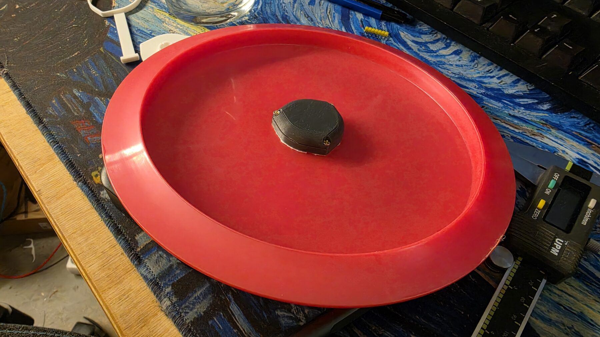
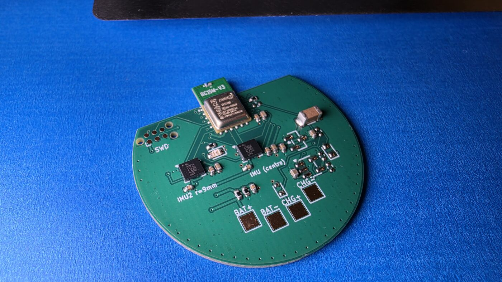
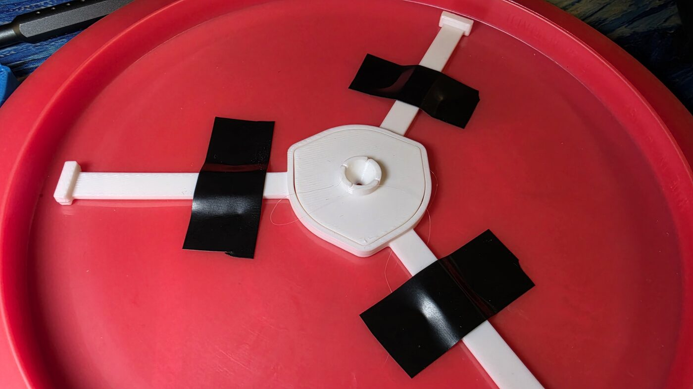
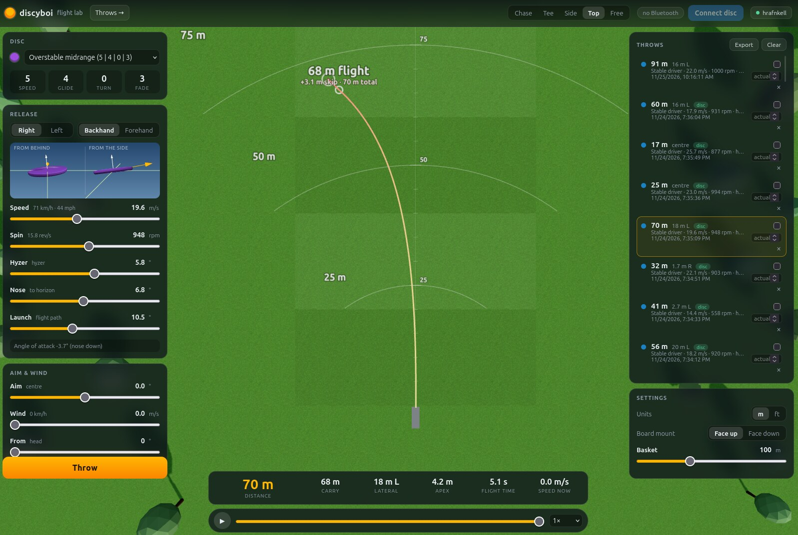
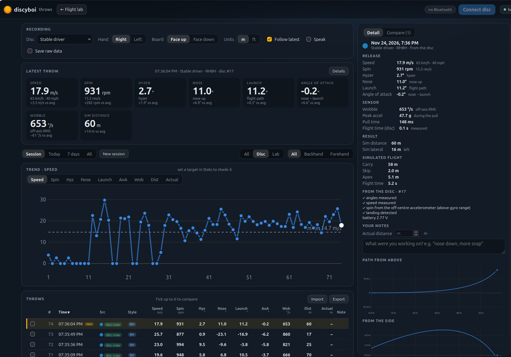

# discyboi

**[discyboi.com](https://discyboi.com)** · [flight lab](https://discyboi.com/lab/)



A flight tracker that mounts on a disc golf disc and reports each throw over Bluetooth. The goal is enough sensor data for reliable flight prediction:

- release detection and release speed
- hyzer angle and nose angle
- spin rate
- wobble / off-axis torque

The hardware is a small round PCB built around an nRF54L15 BLE SoC and IMUs read over SPI. It runs from a CR2032 coin cell and mounts in a small screw-on case under the flight plate, or can be sealed (potted or conformal-coated) into the disc.

## Hardware

 

The current board is **[v4](v4/)**: Ø34 mm, a Fanstel BC15M module (nRF54L15, PCB antenna), and 2 × LSM6DSV320X (one at the centre, one at r = 9 mm). It runs from a CR2032 in a clip on the back, through an MCP1700 3.0 V regulator. The LiPo charger is on the board but not fitted (LIR2032 option). Gerbers and BOMs are in `v4/jlcpcb/`.

Each LSM6DSV320X has a ±320 g high-g accelerometer next to the IMU, and placing one 9 mm off-centre means spin rate can be computed from centripetal acceleration well past the gyro's 4000 dps limit. See the [v4 README](v4/README.md) for specs, the full pinout and how to regenerate the board.

Earlier revisions (v1: bare nRF54L15 + ADXL375, v2: Holyiot module, v3: the v4 design with a LiPo) were removed from the tree; they are in the git history.

## Layout

```
datasheets/            LSM6DSV320X IMU datasheet, TE/Linx coin-cell clip drawings (003 = CR2032, used on v4)
v4/                    KiCad project for the current board
v4/gen/                Python generators for v4's schematic, footprints and PCB (source of truth)
v4/jlcpcb/             fabrication outputs (gerbers, BOM, CPL)
v4/enclosure/          OpenSCAD case (base + screw-on battery lid), STLs, centring jig
firmware/              Zephyr firmware for the v4 board
web/                   discyboi.com: landing page, and the three.js flight lab (simulator, Web Bluetooth client, throw history)
```

## Tools

- KiCad 9 (schematic, PCB, `kicad-cli` for ERC/DRC and exports)
- Freerouting (`~/Downloads/freerouting*.AppImage`) for autorouting v4
- JLCPCB for fabrication. Mouser for the parts (single-supplier BOM)

## Firmware

[`firmware/`](firmware/) holds the Zephyr (v4.0) application for the v4 board. It runs on hardware (both IMUs, motion detection) and takes updates over Bluetooth through MCUboot; real throws are still to be checked. Its analysis maths passes host tests.

- **Detection:** finds throws with a pull/release state machine at 960 Hz, keeping a 3 s ring buffer.
- **Measurements:** release speed, hyzer, nose and launch angles, spin (from the gyro, or centripetal when the gyro saturates), wobble and flight time.
- **BLE:** sends each result, plus the battery level, and can send the raw capture for offline analysis.
- **Build:** `firmware/build.sh` runs the build in Docker. Flashing is over SWD (Tag-Connect), with logs over RTT.

See the [firmware README](firmware/README.md) for the BLE protocol and the bring-up TODO list.

## Web

 

[`web/`](web/) is a browser app (Vite + TypeScript + three.js, run with bun). It simulates disc flights from speed, spin, hyzer, nose and launch angle plus a disc's flight numbers, and animates them in 3D. It receives throws from the disc over Web Bluetooth (or from a fake disc with `?fake=1`) and keeps a throw history. It runs at [discyboi.com](https://discyboi.com): a landing page at `/` and the app under `/lab/`. See the [web README](web/README.md).

## Licence

Open source and open hardware: CERN-OHL-S-2.0 for the hardware, GPL-3.0 for the firmware, AGPL-3.0 for the web app, and CC-BY-SA-4.0 for the photos. Build your own freely; if you share or sell something based on it, credit this project and publish your changes under the same licence. The name "discyboi" is not included. See [LICENSE.md](LICENSE.md).
