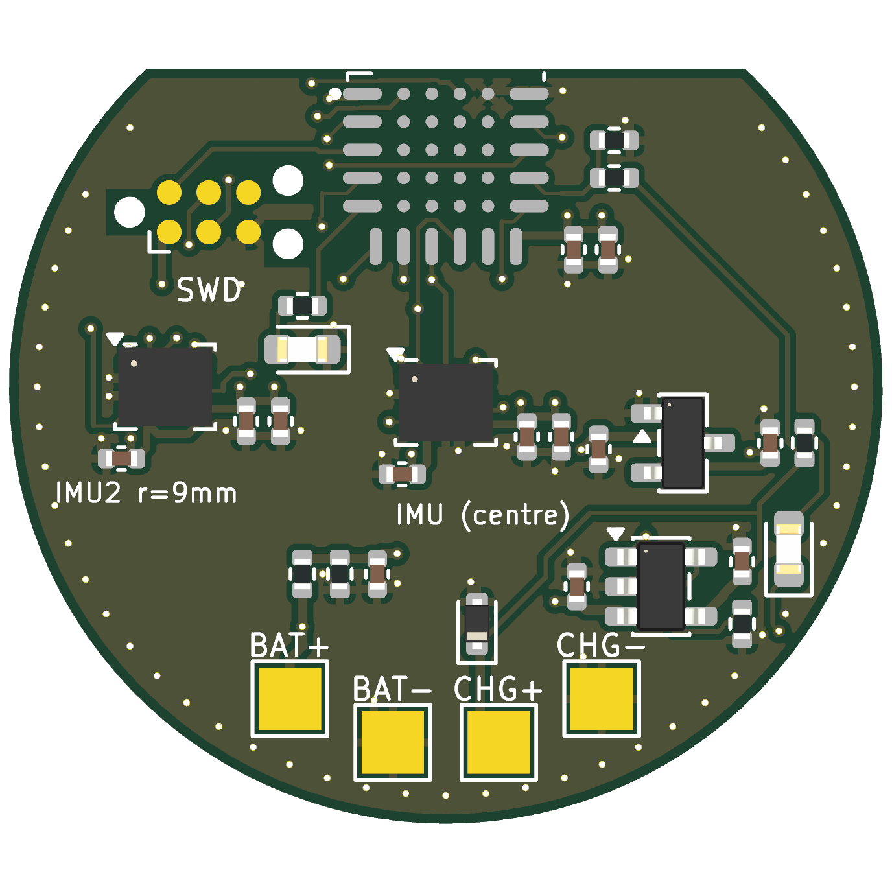

# discyboi v3

Round 28 mm flight-tracker board that sits on a disc golf disc. It has a Fanstel BC15M (nRF54L15) BLE module and two LSM6DSV320X IMUs, and runs from a 1S LiPo with an on-board charger.



## Specs

| | |
|---|---|
| MCU / radio | Fanstel **BC15M**: nRF54L15, BLE, PCB trace antenna. 6.0 × 9.6 mm, 36-pad LGA (6×6, 0.9 mm pitch) |
| IMU (centre) | **LSM6DSV320X** (U5): ±4000 dps gyro, ±16 g low-g accel and ±320 g high-g accel |
| IMU 2 (off-centre) | **LSM6DSV320X** (U3) at r = 9 mm, same orientation as U5 |
| Sensor bus | SPI (SPIM00, port 2), shared SCK/MOSI/MISO, one CS per IMU, two interrupt lines per IMU |
| Battery | 1S LiPo on solder pads (BAT+ / BAT−) |
| Charger | MCP73831-2 (4.2 V), **100 mA** (R7 = 10 k), red LED lit while charging |
| Charge input | 5 V on pads CHG+ / CHG−, with ESD5Z5.0 TVS and 4.7 µF |
| Regulator | MCP1700-3002E LDO → **3.0 V** rail (+3V0) for everything |
| Battery sense | VBAT → 10 M / 10 M divider (+100 nF) → P1.06 / AIN2, so the ADC reads VBAT/2 (≈0.2 µA drain; sample slowly) |
| Charger detect | VCHG → 100 k / 100 k divider → P1.03 (CHG_DET, NFC pad used as GPIO): high while a charger is connected |
| Debug | Tag-Connect TC2030-IDC-NL (no legs): SWD + reset. Logging over RTT |
| Status | Green LED on P2.09 (active high, 1 k) |
| PCB | 4 layers, 1.6 mm, Ø28 mm circle with a straight flat 10.2 mm above centre for the antenna |

### Why two IMUs

The gyro saturates at 4000 dps, which is about **667 rpm**, and discs spin faster than that. U3 sits 9 mm from the centre, so it sees centripetal acceleration a = ω²r. Subtracting U5's reading, which sits at the centre and sees linear and gravity components only, leaves the spin term:

| Range used | Max a | Max spin at r = 9 mm |
|---|---|---|
| Gyro | – | ~667 rpm |
| Low-g accel ±16 g | 157 m/s² | ~1260 rpm |
| High-g accel ±320 g | 3140 m/s² | ~5600 rpm |

U5 at the centre also gives orientation (hyzer, nose angle, wobble) and release and impact detection.

## Pinout

### BC15M module (U1)

Only perimeter pads are used, so every signal escapes on the top layer with no vias under the module. Interrupts are on P0/P1 (GPIOTE30 / GPIOTE20). The SPI lines are on SPIM00's dedicated port-2 pins.

| Pad | nRF54L15 pin | Net | Function |
|---|---|---|---|
| F6 | VDD | +3V0 | Supply (C1 10 µF + C2 100 nF) |
| E1, F1 | GND | GND | |
| A3 | SWDIO | SWDIO | Debug |
| A4 | SWDCLK | SWDCLK | Debug |
| F3 | nRESET | NRESET | Debug / reset |
| C6 | P2.01 | SPI_SCK | SPIM00 SCK |
| D6 | P2.02 | SPI_MOSI | SPIM00 SDO |
| F5 | P2.04 | SPI_MISO | SPIM00 SDI |
| F2 | P2.06 | IMU_CS | U5 (centre IMU) chip select |
| A6 | P2.05 | ACC_CS | U3 (r = 9 mm IMU) chip select |
| A2 | P0.00 | IMU_INT1 | U5 INT1 |
| B1 | P1.08 | IMU_INT2 | U5 INT2 |
| A1 | P0.01 | ACC_INT1 | U3 INT1 |
| D1 | P1.12 | ACC_INT2 | U3 INT2 |
| B6 | P1.06 / AIN2 | VBAT_SENSE | Battery voltage ÷ 2 |
| A5 | P2.09 | LED | Green status LED (D1) via R5 |
| F4 | P1.03 (NFC1) | CHG_DET | Charger present (VCHG ÷ 2). Configure the NFC pads as GPIO |

All other pads are not connected.

### LSM6DSV320X (U5 centre, U3 off-centre)

SPI 4-wire mode. The analog hub / Qvar inputs are tied to GND and the aux SPI pins are left open (datasheet table 2, mode 1).

| Pin | Name | U5 net | U3 net |
|---|---|---|---|
| 1 | SDO/SA0 | SPI_MISO | SPI_MISO |
| 2 | SDx | GND | GND |
| 3 | SCx | GND | GND |
| 4 | INT1 | IMU_INT1 | ACC_INT1 |
| 5 | VDDIO | +3V0 | +3V0 |
| 6, 7 | GND | GND | GND |
| 8 | VDD | +3V0 | +3V0 |
| 9 | INT2 | IMU_INT2 | ACC_INT2 |
| 10 | OCS_Aux | NC | NC |
| 11 | SDO_Aux | NC | NC |
| 12 | CS | IMU_CS | ACC_CS |
| 13 | SCL/SPC | SPI_SCK | SPI_SCK |
| 14 | SDA/SDI | SPI_MOSI | SPI_MOSI |

Decoupling: U5 has C10/C12 100 nF and C11 1 µF. U3 has C19/C20 100 nF and C21 1 µF.

### SWD: Tag-Connect TC2030 (J2)

| Pin | Signal |
|---|---|
| 1 | +3V0 (VTref) |
| 2 | SWDIO |
| 3 | NRESET |
| 4 | SWDCLK |
| 5 | GND |
| 6 | NC |

The footprint is the no-legs version, so use a TC2030-CTX-NL cable with the retaining clip.

### Pads

| Pad | Net | |
|---|---|---|
| TP1 | VBAT | BAT+ |
| TP2 | GND | BAT− |
| TP3 | VCHG | CHG+ (5 V in) |
| TP4 | GND | CHG− |

All four pads are 2 × 2 mm, along the bottom edge.

## Power path

```
CHG+ 5V ──D3 TVS──C13──► MCP73831 (U4, 100 mA, STAT→red LED D2)
                              │
                           VBAT (C14) ── BAT+/BAT− pads (1S LiPo)
                              │       └─ R3/R4 10M:10M ─► VBAT_SENSE (P1.06)
                              ▼
                     MCP1700 3.0 V (U2, C16 in / C17 out) ──► +3V0
```

The MCP1700 drops roughly 180 mV at load. Once the cell falls below about 3.2 V the rail follows VBAT down, and the nRF54L15 and the IMUs keep working down to 1.7 V. Use the VBAT_SENSE reading for the low-battery cutoff.

## PCB

- **Stackup:** F.Cu signals plus GND pour, In1 solid GND, In2 solid +3V0, B.Cu GND pour. GND stitching vias run around the rim.
- **Rules:** 0.12 mm clearance. Tracks are 0.15 mm signal, 0.25 mm +3V0/GND and 0.3 mm VBAT/VCHG. Vias are 0.4 / 0.2 mm, with 0.25 mm copper-to-edge clearance.
- **Antenna:** the module is placed so that its shield/antenna boundary sits on the board flat. The 3.6 mm trace antenna overhangs the edge with no copper under it. Vias are kept out from under the module.
- **Mass:** the battery pads, charger and regulator sit on the lower half to counter the module at the top. Check the balance with the real battery before potting.

## Ordering

- **JLCPCB (PCB + assembly):** `jlcpcb/discyboi-gerbers.zip`, `jlcpcb/discyboi-BOM.csv` and `jlcpcb/discyboi-CPL.csv`.
  - The passives are JLC basic parts.
  - **The LSM6DSV320X has no LCSC code.** Source it separately or as a consigned part.
  - The BC15M, test pads and Tag-Connect are not in the BOM or CPL.
- **Mouser:** `discyboi-mouser-BOM.csv` lists every part with its MPN, including the BC15M (Mouser 308-BC15M). Use it for hand assembly or for the parts JLC doesn't stock.
- **BC15M:** it's an LGA, so it needs paste and reflow (stencil + hot plate/air). An iron alone won't do. The edge pads extend 0.3 mm past the module outline so the joints can be inspected and touched up.

## Regenerating

The board is generated from code. Don't hand-edit `discyboi.kicad_sch` / `discyboi.kicad_pcb`, because the next build overwrites them.

| File | Contents |
|---|---|
| `gen/design.py` | Single source of truth: parts, nets, pin maps, MPN/LCSC codes, schematic placement |
| `gen/gen_fp.py` | BC15M footprint (from the Fanstel mechanical drawing) |
| `gen/gen_sch.py`, `gen/write_pro.py` | Schematic, symbols and project |
| `gen/_head.py` … `gen/_tail.py` | PCB build: outline, placement (`PC` in `_head.py`), zones, plane escapes, Freerouting, stitching. `assemble.sh` concatenates them into `build_pcb.py` |
| `gen/all.sh` | Full build plus ERC and DRC (reports go to `erc2.rpt` / `drc2.rpt`) |
| `gen/make_jlc.sh` | Gerbers, drill, CPL and the JLC + Mouser BOMs |

```sh
gen/all.sh        # needs KiCad 9 (pcbnew python + kicad-cli) and Freerouting in ~/Downloads
gen/make_jlc.sh
```

Set `ROUTER=grid` to use the built-in grid router instead of Freerouting.

## Firmware notes

- The nRF54L15 has no USB, so programming is over SWD (J-Link / nRF Connect) and logging over RTT. Field updates are done with BLE DFU.
- Configure SPIM00 on P2.01/P2.02/P2.04, with chip selects on P2.06 (U5) and P2.05 (U3).
- To measure the battery, read AIN2 and multiply by 2.
