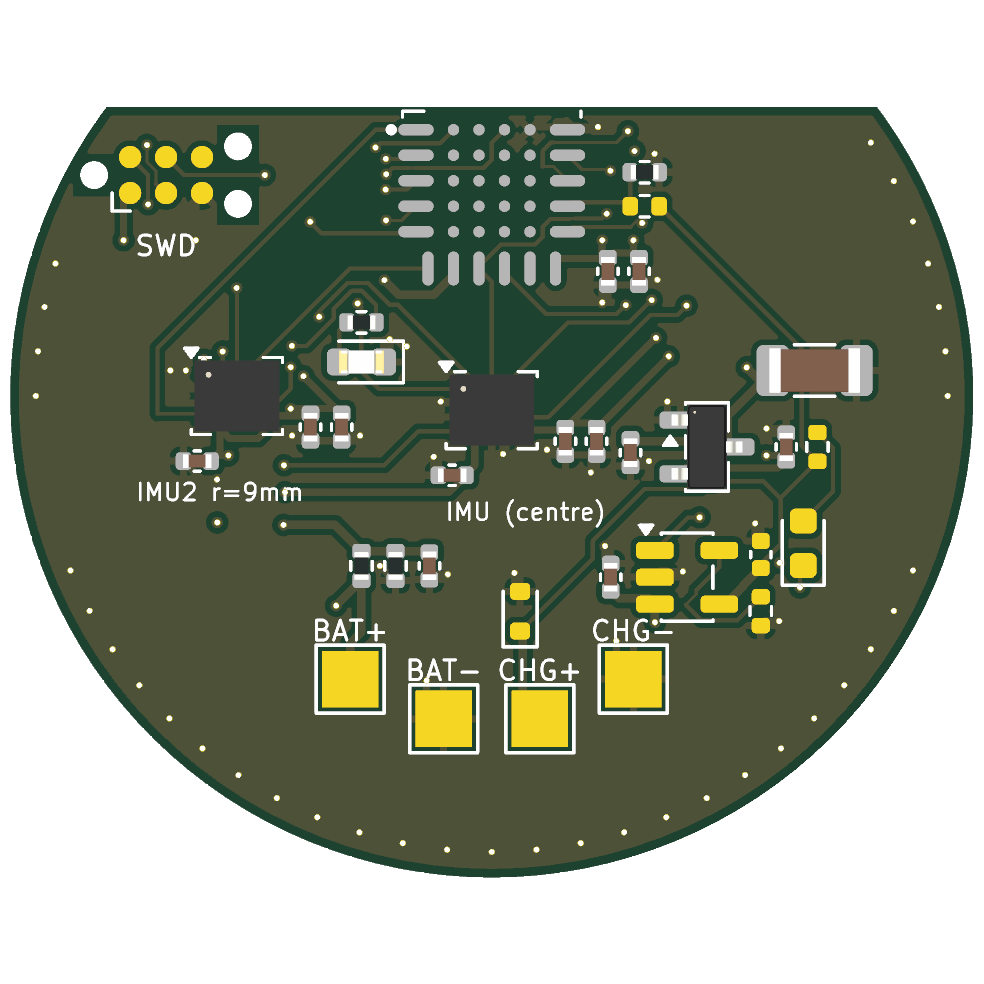
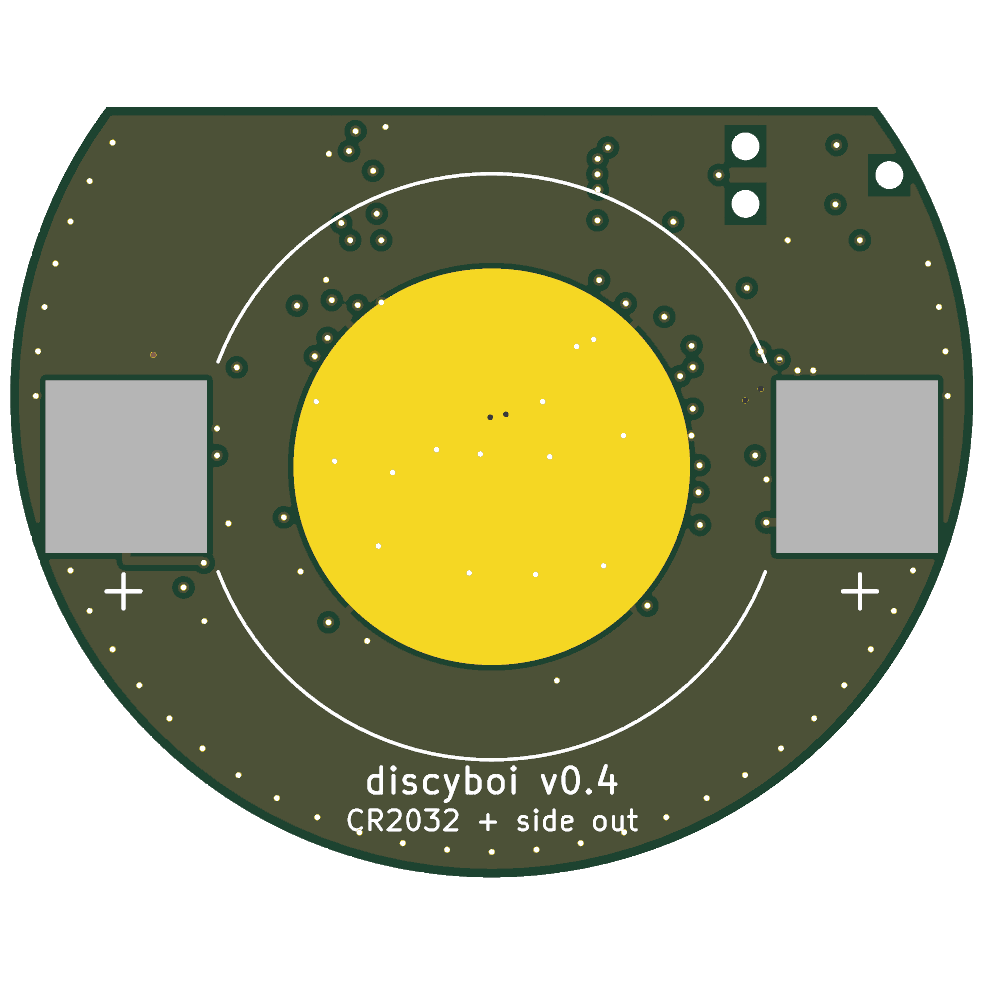

# discyboi v4

Round 34 mm flight-tracker board that sits on a disc golf disc. It has a Fanstel BC15M (nRF54L15) BLE module and two LSM6DSV320X IMUs, and runs from a **CR2032 coin cell** in a clip on the back of the board.

v4 is v3 (now only in the git history) with the LiPo replaced by a replaceable coin cell, because small LiPo cells are hard to get shipped. The electronics, pinout and firmware are otherwise the same. The LiPo charger stays on the board but is **not fitted** (DNP). Fit it only if you use a rechargeable LIR2032.

| Top | Bottom (seen from below) |
|---|---|
|  |  |

## Specs

| | |
|---|---|
| MCU / radio | Fanstel **BC15M**: nRF54L15, BLE, PCB trace antenna. 6.0 × 9.6 mm, 36-pad LGA (6×6, 0.9 mm pitch) |
| IMU (centre) | **LSM6DSV320X** (U5): ±4000 dps gyro, ±16 g low-g accel and ±320 g high-g accel |
| IMU 2 (off-centre) | **LSM6DSV320X** (U3) at r = 9 mm, same orientation as U5 |
| Sensor bus | SPI (SPIM00, port 2), shared SCK/MOSI/MISO, one CS per IMU, two interrupt lines per IMU |
| Battery | **CR2032** in a TE/Linx **BAT-HLD-003-SMT** clip (BT1) on the bottom side. The cell's negative face sits on a Ø14 mm pad; the clip is the + contact |
| Bulk capacitor | C22 100 µF (1206) on VBAT, which supplies the radio's transmit bursts so the coin cell doesn't sag |
| Charger (**DNP**) | MCP73831-2 (U4) with R7 = 47 k (~21 mA), D2, R8, C13, D3 and R9 are not fitted. Fit them only for a rechargeable **LIR2032**. **Never fit them with a CR2032 in the clip** |
| Regulator | MCP1700-3002E LDO → **3.0 V** rail (+3V0) for everything |
| Battery sense | VBAT → 10 M / 10 M divider (+100 nF) → P1.06 / AIN2, so the ADC reads VBAT/2 (≈0.2 µA drain; sample slowly) |
| Charger detect | R9 (DNP) / R10 100 k → P1.03 (CHG_DET, NFC pad used as GPIO). With R9 unfitted, R10 holds it low |
| Debug | Tag-Connect TC2030-IDC-NL (no legs): SWD + reset. Logging over RTT |
| Status | Green LED on P2.09 (active high, 1 k) |
| PCB | 4 layers, Ø34 mm circle with a straight flat 10.2 mm above centre for the antenna. Finish: lead-free **HASL** (free, long shelf life), ENIG (flattest, costs extra) or OSP (flat, but short shelf life). See Ordering |

### Why two IMUs

The gyro saturates at 4000 dps, which is about **667 rpm**, and discs spin faster than that. U3 sits 9 mm from the centre, so it sees centripetal acceleration a = ω²r. Subtracting U5's reading, which sits at the centre and sees linear and gravity components only, leaves the spin term:

| Range used | Max a | Max spin at r = 9 mm |
|---|---|---|
| Gyro | – | ~667 rpm |
| Low-g accel ±16 g | 157 m/s² | ~1260 rpm |
| High-g accel ±320 g | 3140 m/s² | ~5600 rpm |

U5 at the centre also gives orientation (hyzer, nose angle, wobble) and release and impact detection.

## Pinout

### BC15M module (U1)

Only perimeter pads are used, so every signal escapes on the top layer with no vias under the module. Interrupts are on P0/P1 (GPIOTE30 / GPIOTE20). The SPI lines are on SPIM00's dedicated port-2 pins.

| Pad | nRF54L15 pin | Net | Function |
|---|---|---|---|
| F6 | VDD | +3V0 | Supply (C1 10 µF + C2 100 nF) |
| E1, F1 | GND | GND | |
| A3 | SWDIO | SWDIO | Debug |
| A4 | SWDCLK | SWDCLK | Debug |
| F3 | nRESET | NRESET | Debug / reset |
| C6 | P2.01 | SPI_SCK | SPIM00 SCK |
| D6 | P2.02 | SPI_MOSI | SPIM00 SDO |
| F5 | P2.04 | SPI_MISO | SPIM00 SDI |
| F2 | P2.06 | IMU_CS | U5 (centre IMU) chip select |
| A6 | P2.05 | ACC_CS | U3 (r = 9 mm IMU) chip select |
| A2 | P0.00 | IMU_INT1 | U5 INT1 |
| B1 | P1.08 | IMU_INT2 | U5 INT2 |
| A1 | P0.01 | ACC_INT1 | U3 INT1 |
| D1 | P1.12 | ACC_INT2 | U3 INT2 |
| B6 | P1.06 / AIN2 | VBAT_SENSE | Battery voltage ÷ 2 |
| A5 | P2.09 | LED | Green status LED (D1) via R5 |
| F4 | P1.03 (NFC1) | CHG_DET | Charger present (VCHG ÷ 2). Configure the NFC pads as GPIO |

All other pads are not connected.

### LSM6DSV320X (U5 centre, U3 off-centre)

SPI 4-wire mode. The analog hub / Qvar inputs are tied to GND and the aux SPI pins are left open (datasheet table 2, mode 1).

| Pin | Name | U5 net | U3 net |
|---|---|---|---|
| 1 | SDO/SA0 | SPI_MISO | SPI_MISO |
| 2 | SDx | GND | GND |
| 3 | SCx | GND | GND |
| 4 | INT1 | IMU_INT1 | ACC_INT1 |
| 5 | VDDIO | +3V0 | +3V0 |
| 6, 7 | GND | GND | GND |
| 8 | VDD | +3V0 | +3V0 |
| 9 | INT2 | IMU_INT2 | ACC_INT2 |
| 10 | OCS_Aux | NC | NC |
| 11 | SDO_Aux | NC | NC |
| 12 | CS | IMU_CS | ACC_CS |
| 13 | SCL/SPC | SPI_SCK | SPI_SCK |
| 14 | SDA/SDI | SPI_MOSI | SPI_MOSI |

Decoupling: U5 has C10/C12 100 nF and C11 1 µF. U3 has C19/C20 100 nF and C21 1 µF.

### SWD: Tag-Connect TC2030 (J2)

| Pin | Signal |
|---|---|
| 1 | +3V0 (VTref) |
| 2 | SWDIO |
| 3 | NRESET |
| 4 | SWDCLK |
| 5 | GND |
| 6 | NC |

The footprint is the no-legs version, so use a TC2030-CTX-NL cable with the retaining clip. J2 sits at the top left so the cable's guide pins, which poke through the board, clear the coin cell on the back. Or solder thin wires to the pads for bring-up.

### Pads

| Pad | Net | |
|---|---|---|
| TP1 | VBAT | BAT+ (bench supply / measuring) |
| TP2 | GND | BAT− |
| TP3 | VCHG | CHG+ (5 V in, LIR2032 build only) |
| TP4 | GND | CHG− |

All four pads are 2 × 2 mm, along the bottom edge of the top side. With a CR2032 build, don't connect anything to CHG+.

## Power path

```
BT1 CR2032 (clip, bottom) ── VBAT ── C22 100 µF, C14 4.7 µF
                              │   └─ R3/R4 10M:10M ─► VBAT_SENSE (P1.06)
                              ▼
                     MCP1700 3.0 V (U2, C16 in / C17 out) ──► +3V0

(DNP, LIR2032 only)  CHG+ 5V ──D3──C13──► MCP73831 (U4, 21 mA) ──► VBAT
```

A fresh CR2032 is about 3.0 V, so the MCP1700 is in dropout and the rail simply follows the cell (≈2.6–3.0 V for most of its life). The nRF54L15 and both IMUs run down to about 1.7–1.8 V, so the cell can be used almost to empty.

**Runtime (estimate).** About 1.7–2 mA while armed (both IMUs at 960 Hz plus the CPU) and 11 µA in deep sleep. A CR2032 gives roughly 150–180 mAh at that load, so about 35–40 rounds of two hours armed time. Cold weather reduces this. The radio's 5–10 mA transmit bursts come mostly from C22.

**Battery level.** The firmware detects the battery type (`CONFIG_DISCY_BATTERY_AUTO`, default): coin-cell curve (3.0 V = 100 %, 2.0 V = 0 %) until VBAT is seen above 3.45 V, then the LiPo curve.

## LiPo build (same board)

The same board can run from a 1S LiPo instead of the coin cell, for example a 20 × 20 × 4.5 mm, 150 mAh pouch.

**Each board is either a coin-cell build or a LiPo build, never both.** A LiPo or a 5 V charger connected to a primary CR2032 forces current into it, and that can make the cell leak, swell or catch fire. On a LiPo board, leave the clip off.

| | Coin-cell build | LiPo build |
|---|---|---|
| BT1 clip | Fitted | **Not fitted** |
| Battery | CR2032 in the clip | LiPo leads: + to a clip tab pad (or TP1 BAT+), − to the round pad's edge (or TP2 BAT−) |
| U4, R8, D2, C13, D3, R9 | Not fitted | Fitted |
| R7 (charge current = 1000 V / R7) | Not fitted | **10 k = 100 mA** for 150 mAh (≈0.7C) |
| Charging | – | 5 V on CHG+ / CHG− (TP3 / TP4). The red LED is lit while charging |
| CHG_DET (P1.03) | Held low by R10 | High while a charger is connected |

Notes for the LiPo build:
- **Use a protected cell.** It needs a protection PCB on the tabs for over-discharge and short-circuit. Small pouch cells often have it, which makes them a couple of mm longer than the nominal size.
- **Insulate the cell from the board.** Put a layer of Kapton tape over the bottom of the board before you stick the cell there, so the pouch can't rub through to the exposed round pad or the vias.
- **Placement:** the 20 × 20 mm cell fits on the bottom in the same place as the coin cell, centred 2.5 mm below the board centre, so balance and antenna clearance stay the same.
- **Regulator:** the LDO now regulates properly to 3.0 V. Nothing else on the board changes.
- **Same firmware:** it switches to the LiPo battery curve on its own once VBAT is above 3.45 V.

## PCB

- **Stackup:** F.Cu signals plus GND pour, In1 solid GND, In2 solid +3V0, B.Cu GND pour. GND stitching vias run around the rim.
- **Rules:** 0.12 mm clearance. Tracks are 0.15 mm signal, 0.25 mm +3V0/GND and 0.3 mm VBAT/VCHG. Vias are 0.45 / 0.2 mm (JLC charges for a 4-wire Kelvin test on 0.4 / 0.2 mm vias), with 0.25 mm copper-to-edge clearance.
- **Antenna:** the module is placed so that its shield/antenna boundary sits on the board flat. The 3.6 mm trace antenna overhangs the edge with no copper under it. Vias are kept out from under the module.
- **Coin cell:** the cell centre is 2.5 mm below the board centre, which keeps it more than 2 mm from the antenna edge and partly balances the module at the top. The clip's open end faces the module and the cell slides in from that side.
  - The negative pad is Ø14 mm instead of the 17.9 mm in TE's drawing. A CR2032's flat negative face is wider than that, and the smaller pad leaves a ring of bottom-layer routing under the cell. Those traces stay under solder mask.
  - The pad has GND vias in it. That's fine for a pressure contact.
- **Mass:** the cell is about 3 g. Check the disc's balance with the cell fitted before potting or gluing.

## Ordering

- **JLCPCB (PCB):** upload `jlcpcb/discyboi-gerbers.zip`.
  - 4 layers, **1.0 mm** thick (the enclosure STLs assume 1.0 mm). Use a **0.10 mm** top-side stencil.
  - Surface finish:
    - **Lead-free HASL** (free) suits boards that may sit in a drawer, because it stays solderable for a year or more. The battery's negative pad comes solder-coated, so it needs no treatment unless it's visibly lumpy; then flatten it with the iron and solder wick. HASL pads are slightly domed, so take a little extra care with the 0.5 mm-pitch IMUs: use the 0.10 mm stencil, press each IMU down level after placing it, and inspect after reflow.
    - **ENIG** costs extra. It's the flattest finish and has a long shelf life. The battery pad needs nothing.
    - **OSP** (free) is flat, but assemble within a few months. Tin the battery pad after reflow (flux and solder, then wick it thin and flat), because bare copper oxidises.
  - Order a **top-side** stencil only, 0.10 mm thick.
  - The stencil also has apertures for the unfitted charger pads. The paste just tins those pads, which is harmless and handy if you fit the charger later.
- **JLC assembly (optional):** `jlcpcb/discyboi-BOM.csv` + `discyboi-CPL.csv` cover only the fitted top-side parts. Unfitted parts and the battery clip are left out.
  - **The LSM6DSV320X and the 10 M resistors have no LCSC code.** Source them separately or as consigned parts.
- **Mouser:** `discyboi-mouser-BOM.csv` lists every fitted part with its MPN, including the BC15M (308-BC15M) and the BAT-HLD-003-SMT clip.
  - For a rechargeable build, also buy U4 MCP73831T-2ACI/OT, R8 1 k, D2 (LTST-C191KRKT), C13 4.7 µF, D3 ESD5Z5.0T1G and R9 100 k.
  - R7 depends on the cell: 10 k (RC0402FR-0710KL, 100 mA) for a 150 mAh LiPo, or 47 k (RC0402FR-0747KL, 21 mA) for a LIR2032.
- **Assembly order:**
  1. Paste and reflow the top side (BC15M, IMUs and passives).
  2. Hand-solder the battery clip's two tabs on the bottom with an iron. The round negative pad must stay flat: leave it as delivered on HASL or ENIG, and tin it thin and flat on OSP.
- **BC15M:** it's an LGA, so it needs paste and reflow (stencil + hot plate/air). An iron alone won't do.
- **Placement map:** open `assembly.html` in a browser. It shows where each part goes and which way round, for the CR2032, LIR2032 or LiPo build, with tick-boxes and the hot-plate reflow profile.

## Enclosure

[`enclosure/`](enclosure/) has an OpenSCAD case: a base glued under the disc, and a lid with three M2 screws that doubles as the battery door. It's 9.6 mm tall with a coin cell and the 1.0 mm board, and there are STLs for both the coin-cell and LiPo builds, plus a centring jig.

## Regenerating

The board is generated from code. Don't hand-edit `discyboi.kicad_sch` / `discyboi.kicad_pcb`, because the next build overwrites them.

| File | Contents |
|---|---|
| `gen/design.py` | Single source of truth: parts, nets, pin maps, MPN/LCSC codes, schematic placement |
| `gen/gen_fp.py` | BC15M footprint (from the Fanstel mechanical drawing) and the BAT-HLD-003-SMT clip (from TE drawing C-BAT-HLD-003-SMT) |
| `gen/gen_sch.py`, `gen/write_pro.py` | Schematic, symbols and project |
| `gen/_head.py` … `gen/_tail.py` | PCB build: outline, placement (`PC` in `_head.py`), zones, plane escapes, Freerouting, stitching. `assemble.sh` concatenates them into `build_pcb.py` |
| `gen/all.sh` | Full build plus ERC and DRC (reports go to `erc2.rpt` / `drc2.rpt`) |
| `gen/make_jlc.sh` | Gerbers, drill, CPL and the JLC + Mouser BOMs (unfitted and bottom-side parts excluded from the JLC files) |

```sh
gen/all.sh        # needs KiCad 9 (pcbnew python + kicad-cli) and Freerouting in ~/Downloads
gen/make_jlc.sh
```

Set `ROUTER=grid` to use the built-in grid router instead of Freerouting.

## Firmware notes

- The nRF54L15 has no USB, so programming is over SWD (J-Link / nRF Connect) and logging over RTT. Field updates are done with BLE DFU.
- Configure SPIM00 on P2.01/P2.02/P2.04, with chip selects on P2.06 (U5) and P2.05 (U3).
- To measure the battery, read AIN2 and multiply by 2.
- Battery level: the firmware detects coin cell vs LiPo from VBAT (`CONFIG_DISCY_BATTERY_AUTO`, default), or force it with `CONFIG_DISCY_BATTERY_COIN` / `CONFIG_DISCY_BATTERY_LIPO`.

## Licence

The v4 hardware (schematic, PCB, generators in `gen/`, fabrication files in `jlcpcb/` and the enclosure in `enclosure/`) is licensed under the [CERN Open Hardware Licence v2, strongly reciprocal](../LICENSES/CERN-OHL-S-2.0.txt) (CERN-OHL-S-2.0). See [LICENSE.md](../LICENSE.md).

Source location: https://github.com/hrafnkell/discyboi
