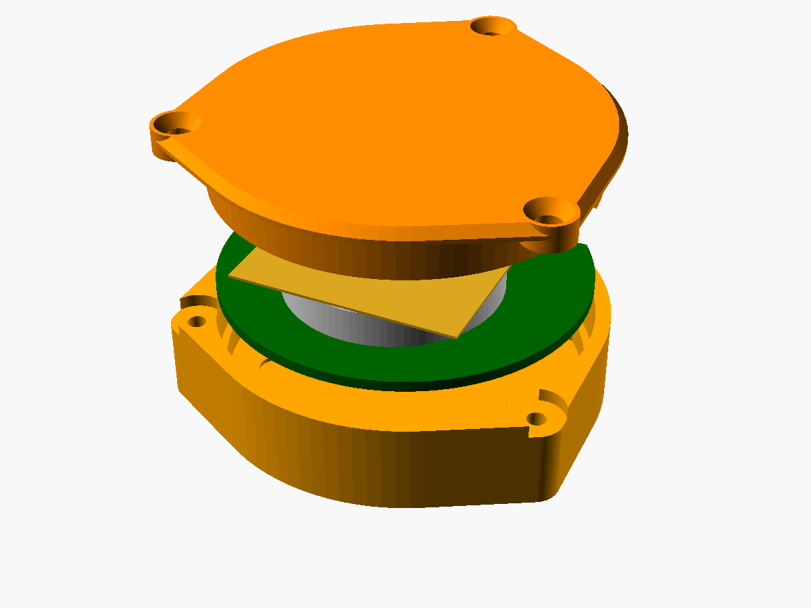

# discyboi v4 enclosure

An OpenSCAD case for the Ø34 mm v4 board. A **base** is glued under the centre of the disc's flight plate, and a rounded **lid** held by three M2 screws is the battery door.

This is **rev 2**. Base and lid now split at the board's battery side, so the lid is a domed cap with a 5 mm round-over (3 mm on the LiPo build) that blends into the disc. The height and footprint are the same as rev 1, which has a flat lid plate with a small chamfer and is still here because it's easier to print (see [Rev 1](#rev-1-flat-lid)). Rev 1 and rev 2 parts don't mix.


| | Coin cell (CR2032) | LiPo (20 × 20 × 4.5 mm) |
|---|---|---|
| Height | **9.6 mm** (with the 1.0 mm board) | 10.3 mm |
| Width | 42.8 mm across the screw lobes, 37.4 mm round body | same |
| Files | `stl/base.stl`, `stl/lid_coin.stl` | `stl/base_lipo.stl` (with a charge-wire slot), `stl/lid_lipo.stl` |

The STLs are for a **1.0 mm** board (`pcb_t = 1.0`). For a different thickness, set `pcb_t` and re-export; the case height changes by the same amount.

## How it fits together

- **Board orientation:** components face the disc, and the battery faces the ground. Use **"Face up"** for the board mount in the web app, because the board's top side points at the disc's top.
- **Base:**
  - The board's top face rests on a rim ledge outside every component.
  - Two keys along the board's flat edge support it there and stop it rotating. The gap between them is the module's antenna, which overhangs the flat.
  - The floor is 0.8 mm thick, with 0.4 mm windows over the green status LED (and the red charge LED on a LiPo build). **Print the base in a translucent or natural filament** to see the LEDs through it, or check the LED before you mount the case.
- **Lid:**
  - Its flat underside sits on the base and clamps the whole battery side of the board onto the ledge. Nothing but the clip is on that side.
  - Shallow recesses clear the clip's solder tabs, and a deeper one is shaped to the clip (or the LiPo pouch).
  - A boss in that recess presses the middle of the clip, or the LiPo, down by `press` = 0.25 mm.
  - The recess fits the clip closely, so an impact can't slide the cell out of the clip's open end.
  - The screw heads sit in counterbores in the round-over. On the outer side these open out of the curve as a small notch.
- **Battery swap:** take out the three screws, lift the lid, and slide the cell out of the clip's open end (towards the antenna side).
- **Reprogramming:** J2 (SWD) faces the disc, so take the board out of the base to reach it. Later firmware updates can go over BLE DFU.
- **LiPo build:** the CHG pads face the disc too. `base_lipo.stl` has a slot in the wall for two thin charge wires, for example to a magnetic 2-pin connector glued to the side.

## Printing

- **Material:** PETG or TPU, not PLA, which gets brittle in the cold and cracks on tree hits.
- **Settings:** 0.2 mm layers (0.12 mm improves the LED windows), 4 perimeters, 100 % infill. The parts are small, so they end up nearly solid anyway.
- **Orientation:** the base goes disc face down. The lid goes **flat underside down, dome up**. The STLs are already laid out that way. Neither needs supports; the clip recess's ceiling is a short bridge.
- **Screws:** 3 × **M2 × 6 mm countersunk** (rev 1 used 8 mm, which would now go through the floor). They self-tap about 3.4 mm into the 1.7 mm pilot holes in the base. Drive them gently; PETG strips easily.
- **Mass:** about 7 g of plastic if printed solid, because the domed lid is mostly solid (rev 1 was about 6 g). 40 % infill brings it back to about 5 g. With the board (~3 g) and a CR2032 (~3 g) the total is about 12–14 g, compared with ~175 g for a disc. That's fine for practice, but a disc carrying it isn't PDGA legal.

## Rev 1 (flat lid)

`discyboi_case_rev1.scad`, STLs in `stl/rev1/` (`base.stl`, `lid_coin.stl`, `base_lipo.stl`, `lid_lipo.stl`).



- **Shape:** the base wall goes up to 1.2 mm below the top, and the lid is a flat plate with a 0.8 mm chamfer, a clamp ring on the board rim, a boss on the clip and a stop wall across the clip's open end.
- **Printing:** the lid prints outer face down, which gives a smooth flat outside and no bridges. Same material and settings as rev 2.
- **Screws:** 3 × **M2 × 8 mm countersunk**, self-tapping into posts in the base.
- **Mass:** about 6 g of plastic printed solid.
- The jig and sight are the same for both revisions; the base footprint didn't change.

Re-generate with the same commands as below, using `discyboi_case_rev1.scad` and writing to `stl/rev1/`.

## Mounting on the disc

1. Clean the underside of the flight plate with isopropyl alcohol.
2. Stick the base on with a disc of 3M VHB tape, 0.6–1.1 mm thick. The flight plate's curvature over 43 mm is under 0.1 mm, so a flat base is fine.
3. Centre it carefully, because the centre IMU must sit on the spin axis. There are two ways, both using a three-armed jig whose centre pocket holds the base.

**On the injection mark (recommended).** Discs are injected through the centre of the underside, which leaves a small dimple or nub exactly on the axis. This works for any disc without measuring.
1. Print `stl/jig_dimple.stl` and `stl/sight.stl`. The sight has the base's footprint, lobes included, with a conical hole down the middle and tick marks on its top edge.
2. Drop the jig into the upturned disc and put the sight in its pocket.
3. Slide the jig until the injection mark sits in the middle of the sight's hole, then tape the three arm pads down with masking tape.
4. Lift the sight out by its grip ring, put the VHB on the base, and press the base into the pocket. It sits exactly where the sight was.
5. Peel the tape and lift the jig off.

If the mark is a raised nub rather than a dimple, the 5 mm hole clears it. The VHB under the real base absorbs a nub up to about half the tape thickness, so trim a taller one flush first.

**On the rim.** `stl/jig.stl` has arms that reach the rim and centre themselves:
1. Measure the inside diameter of your disc's rim, at the flight plate.
2. Set `disc_inner_d` to it and re-export the jig. The default is 165 mm; driver and putter rims differ.
3. Drop the jig into the upturned disc, push the base through its centre pocket onto the tape, and lift the jig out.

## Re-generating

```sh
openscad -o stl/base.stl     -D 'part="base"' discyboi_case.scad
openscad -o stl/lid_coin.stl -D 'part="lid"'  discyboi_case.scad
openscad -o stl/base_lipo.stl -D 'part="base"' -D 'battery="lipo"' -D 'charge_notch=true' discyboi_case.scad
openscad -o stl/lid_lipo.stl  -D 'part="lid"'  -D 'battery="lipo"' discyboi_case.scad
openscad -o stl/jig.stl      -D 'part="jig"' -D 'disc_inner_d=165' discyboi_case.scad
openscad -o stl/jig_dimple.stl -D 'part="jig"' -D 'jig_mode="dimple"' discyboi_case.scad
openscad -o stl/sight.stl    -D 'part="sight"' discyboi_case.scad
```

Or open `discyboi_case.scad` in OpenSCAD and use the Customizer:
- **`part`:** `assembly`, `exploded`, `base`, `lid`, `jig`, `sight` or `print`.
- **`jig_mode`:** `rim` or `dimple`.
- **`battery`:** `coin` or `lipo`.
- **Dimensions:** `pcb_t`, `clr`, `press`, `wall` and `floor_t`.
- **`round_r`:** the lid's round-over radius. 0 picks the largest that keeps 1 mm of lid over the clip's corners: 5 mm for the coin cell, 3 mm for the LiPo.
- **`screw_l`:** screw length. The counterbores are sunk so the tips stop at the floor.

The positions of the module, LEDs, clip and cell come from `v4/discyboi.kicad_pcb`. If the board layout changes, update the constants at the top of the file.

**Fit checks:** the parts were checked for collisions in OpenSCAD:
- No overlap between the base and the board, the top-side parts or the module antenna.
- No overlap between the lid and the board, the clip (modelled from its drawing, `datasheets/ENG_CD_C_BAT_HLD_003_SMT_A.pdf`), its solder tabs or the LiPo pouch.
- The base and lid only meet face to face.
- The only interference is the deliberate 0.25 mm press on the battery.
