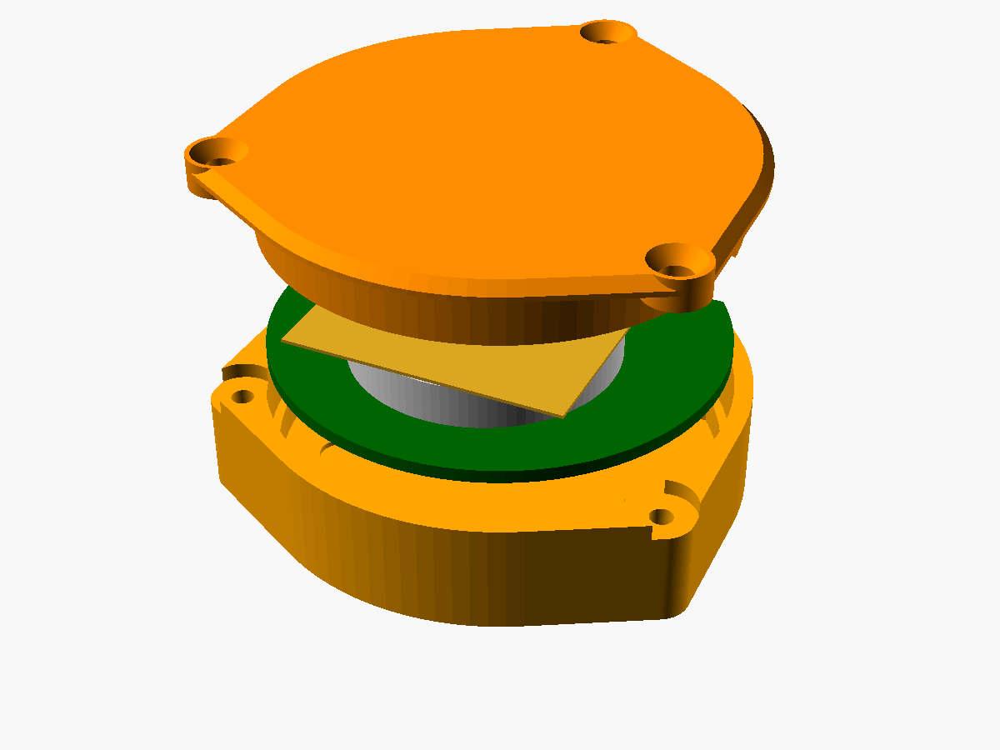

# discyboi v4 enclosure

An OpenSCAD case for the Ø34 mm v4 board. A **base** is glued under the centre of the disc's flight plate, and a **lid** held by three M2 screws is the battery door.



| | Coin cell (CR2032) | LiPo (20 × 20 × 4.5 mm) |
|---|---|---|
| Height | **9.6 mm** (with the 1.0 mm board) | 10.3 mm |
| Width | 42.8 mm across the screw lobes, 37.4 mm round body | same |
| Files | `stl/base.stl`, `stl/lid_coin.stl` | `stl/base_lipo.stl` (with a charge-wire slot), `stl/lid_lipo.stl` |

The STLs are for a **1.0 mm** board (`pcb_t = 1.0`). For a different thickness, set `pcb_t` and re-export; the case height changes by the same amount.

## How it fits together

- **Board orientation:** components face the disc, and the battery faces the ground. Use **"Face up"** for the board mount in the web app, because the board's top side points at the disc's top.
- **Base:**
  - The board's top face rests on a rim ledge outside every component.
  - Two keys along the board's flat edge support it there and stop it rotating. The gap between them is the module's antenna, which overhangs the flat.
  - The floor is 0.8 mm thick, with 0.4 mm windows over the green status LED (and the red charge LED on a LiPo build). **Print the base in a translucent or natural filament** to see the LEDs through it, or check the LED before you mount the case.
- **Lid:**
  - A clamp ring presses the board onto the ledge. It's notched where the clip's solder tabs are.
  - A boss presses the clip, or the LiPo, down by `press` = 0.25 mm.
  - A stop wall sits across the clip's open end, so an impact can't slide the cell out.
- **Battery swap:** take out the three screws, lift the lid, and slide the cell out of the clip's open end (towards the antenna side).
- **Reprogramming:** J2 (SWD) faces the disc, so take the board out of the base to reach it. Later firmware updates can go over BLE DFU.
- **LiPo build:** the CHG pads face the disc too. `base_lipo.stl` has a slot in the wall for two thin charge wires, for example to a magnetic 2-pin connector glued to the side.

## Printing

- **Material:** PETG or TPU, not PLA, which gets brittle in the cold and cracks on tree hits.
- **Settings:** 0.2 mm layers (0.12 mm improves the LED windows), 4 perimeters, 100 % infill. The parts are small, so they end up nearly solid anyway.
- **Orientation:** the base goes disc face down and the lid outer face down. The STLs are already laid out that way. Neither needs supports.
- **Screws:** 3 × **M2 × 8 mm countersunk**. They self-tap into the 1.7 mm pilot holes in the posts. Drive them gently; PETG strips easily.
- **Mass:** about 6 g of plastic if printed solid. With the board (~3 g) and a CR2032 (~3 g) the total is about 12–13 g, compared with ~175 g for a disc. That's fine for practice, but a disc carrying it isn't PDGA legal.

## Mounting on the disc

1. Clean the underside of the flight plate with isopropyl alcohol.
2. Stick the base on with a disc of 3M VHB tape, 0.6–1.1 mm thick. The flight plate's curvature over 43 mm is under 0.1 mm, so a flat base is fine.
3. Centre it carefully, because the centre IMU must sit on the spin axis. `stl/jig.stl` is a three-armed centring spider:
   1. Measure the inside diameter of your disc's rim, at the flight plate.
   2. Set `disc_inner_d` to it and re-export the jig.
   3. Drop the jig into the upturned disc, push the base through its centre pocket onto the tape, and lift the jig out.

The default `disc_inner_d` is 165 mm, so measure your disc. Driver and putter rims differ.

## Re-generating

```sh
openscad -o stl/base.stl     -D 'part="base"' discyboi_case.scad
openscad -o stl/lid_coin.stl -D 'part="lid"'  discyboi_case.scad
openscad -o stl/base_lipo.stl -D 'part="base"' -D 'battery="lipo"' -D 'charge_notch=true' discyboi_case.scad
openscad -o stl/lid_lipo.stl  -D 'part="lid"'  -D 'battery="lipo"' discyboi_case.scad
openscad -o stl/jig.stl      -D 'part="jig"' -D 'disc_inner_d=165' discyboi_case.scad
```

Or open `discyboi_case.scad` in OpenSCAD and use the Customizer:
- **`part`:** `assembly`, `exploded`, `base`, `lid`, `jig` or `print`.
- **`battery`:** `coin` or `lipo`.
- **Dimensions:** `pcb_t`, `clr`, `press`, `wall` and `floor_t`.

The positions of the module, LEDs, clip and cell come from `v4/discyboi.kicad_pcb`. If the board layout changes, update the constants at the top of the file.

**Fit checks:** the parts were checked for collisions in OpenSCAD:
- No overlap between the base and the board, the top-side parts or the module antenna.
- No overlap between the lid and the board or the cell.
- The base and lid only meet face to face.
- The only interference is the deliberate 0.25 mm press on the battery.
